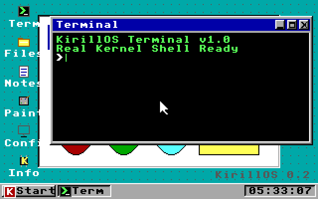
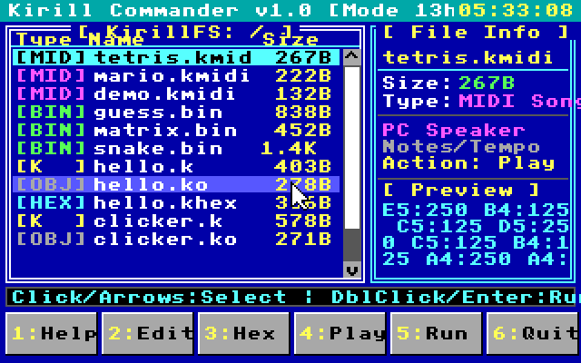
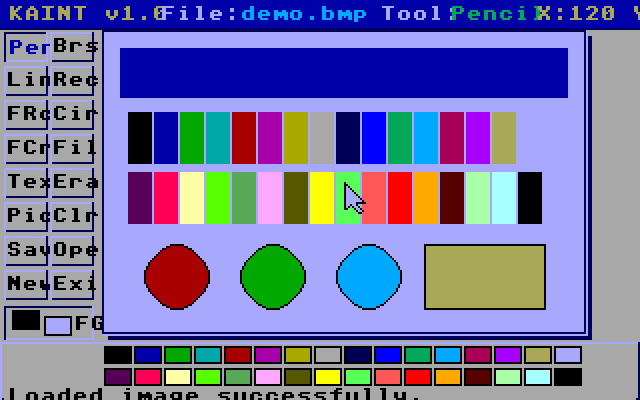
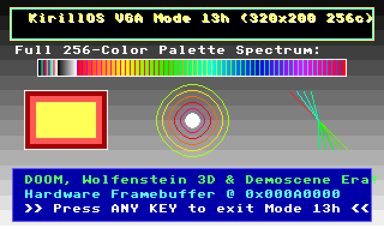
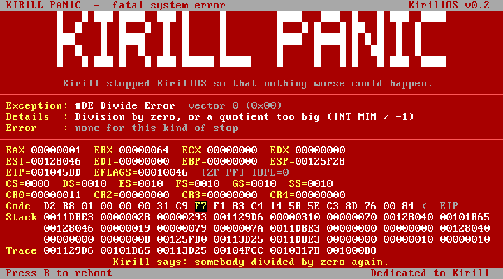

<div align="center">

<h1>KirillOS <sup>v0.2</sup></h1>

<pre>
  _  ___      _ _ _  ____   _____
 | |/ (_)    (_) | |/ __ \ / ____|
 | ' / _ _ __ _| | | |  | | (___
 |  &lt; | | '__| | | | |  | |\___ \
 | . \| | |  | | | | |__| |____) |
 |_|\_\_|_|  |_|_|_|\____/|_____/   v0.2
</pre>

**Минималистичная 32-битная ОС для x86, написанная с нуля:**<br>
свой загрузчик, файловая система, язык программирования, редакторы, сеть, звук и оконный рабочий стол.

[](LICENSE)
-informational)


<br>


[Быстрый старт](#quickstart) ·
[Возможности](#features) ·
[Демо](#demo) ·
[Скриншоты](#screenshots) ·
[Архитектура](#architecture) ·
[Сборка](#build) ·
[Команды](#commands) ·
[Документация](#documentation)

</div>

---

<a id="quickstart"></a>
## 🚀 Быстрый старт

После установки [инструментов сборки](#build) запустите из корня проекта:

```bash
./build.sh --window
```

В окне QEMU сначала введите `boot` в консоли `kboot>`. После появления `KirillOS>` можно попробовать:

| Введите в KirillOS | Что откроется |
| :--- | :--- |
| `kgui` | Оконный рабочий стол с терминалом, файлами и блокнотом |
| `kaint demo.bmp` | Графический редактор с демонстрационным рисунком |
| `kmidi tetris.kmidi` | Трекер: нажмите **Space**, чтобы сыграть мелодию |
| `khexd build hello.k`, затем `run hello.khex` | Сборка и запуск программы на K |
| `run snake.bin` | Змейка: **WASD** или стрелки, **Q** для выхода |

Для запуска без локального окна используйте `./build.sh --vnc` и подключитесь VNC-клиентом к `localhost:5900`.

---

<a id="features"></a>
## ✨ Возможности

<table>
<tr>
<td width="33%" valign="top">

### 🥾 Загрузка
- Свой загрузчик **kboot**: MBR → 32-bit Protected Mode
- Консоль `kboot>` на прерываниях IRQ1 (IDT + PIC 8259A)
- Загрузка ядра **ELF32**, совместимость с **Multiboot** (GRUB)

</td>
<td width="33%" valign="top">

### 💾 Хранение
- **KirillFS**: 16 файлов по 48 КБ
- Хранение на диске **ATA PIO LBA28**
- Работа в RAM, если диска нет

</td>
<td width="33%" valign="top">

### 🧑‍💻 Разработка
- Язык **K** (`.k`) и компилятор **KHEXD**
- `.k` → `.ko` → `.khex`, стековая VM
- Нативные `.bin` программы и системный API

</td>
</tr>
<tr>
<td valign="top">

### 📝 Редакторы
- **Kano**: текстовый редактор в стиле nano
- **Kdhe**: hex-редактор файлов и секторов диска
- **Kaint**: графический редактор с импортом и экспортом BMP

</td>
<td valign="top">

### 🎵 Звук
- **Intel AC'97** (Bus Master DMA, 48 kHz)
- **PC Speaker** как запасной вариант
- **Kmidi**: трекер с клавиатурой-пианино

</td>
<td valign="top">

### 🌐 Сеть
- **Intel e1000** с DMA-кольцами
- ARP, IPv4, ICMP, UDP, **DHCP**, **DNS**
- `ping`, `tcping`, `host`

</td>
</tr>
<tr>
<td valign="top">

### 🖥️ Графика
- **VGA Mode 13h** (320×200, 256 цветов) без BIOS
- **KGUI**: окна, панель задач, меню «Пуск»
- **Kirill Commander**: файловый менеджер в стиле Norton

</td>
<td valign="top">

### 🧯 Kirill Panic
- Своя IDT на все 256 векторов
- Подробный экран перехваченного исключения CPU
- Регистры, код у EIP, стек, trace, `R` = reboot

</td>
<td valign="top">

### 🎮 Программы
- Игры `snake.bin`, `guess.bin`, `matrix.bin`
- Мелодии `tetris`, `mario`, `demo` (`.kmidi`)
- **kfetch**, часы CMOS RTC

</td>
</tr>
</table>

**Блокнот KGUI** открывает до четырёх документов одновременно. Есть Save, Open и Save As, **Ctrl+S / Ctrl+O**, перемещение курсора клавишами и мышью, прокрутка и предупреждение о несохранённых изменениях. Редактирование ограничено 4 КБ; у более крупных файлов доступен просмотр первых 4 КБ без сохранения.

---

<a id="demo"></a>
## 🎬 Демонстрация

> Текстовые демонстрации сняты из видеопамяти VGA (`0xB8000`) KirillOS в QEMU. Длинные экраны местами сокращены, пустые строки убраны. Адреса, время ответа и случайные числа зависят от сборки и запуска.

### 1. Загрузчик kboot

```text
===============================================================================
                       KirillOS Bootloader (kboot v1.0)
         32-bit Protected Mode | Hardware Interrupts: IRQ1 (PIC/IDT)
===============================================================================
Type 'help' for commands. Type 'boot' to start KirillOS.

kboot> boot
```

### 2. Загрузка ядра

```text
[KirillBoot] multiboot info:  0x00009440
[KirillBoot] boot contract: OK
[KirillBoot] loading KirillOS kernel services...
[KirillBoot] handoff -> kernel_main
[cpu] i686 protected mode eflags=0x00000002
[mboot] magic=0x2BADB002 mbi=0x00009440 OK
[mboot] lower=640K upper=130048K (127 MiB)
[vga] text 80x25 framebuf=0x000B8000 16-color
[idt] 256 gates, CPU exceptions -> Kirill Panic OK
[8042] status=0x1C OBF=0 IBF=0 set1 US-QWERTY OK
[pci] enumerating bus 0...
[pci]  00:00.0 8086:1237 [0600] host-bridge
[pci]  00:01.0 8086:7000 [0601] ISA-bridge
[pci]  00:01.1 8086:7010 [0101] IDE
[pci]  00:01.3 8086:7113 [0680] bridge
[pci]  00:02.0 1234:1111 [0300] VGA-compat
[pci]  00:03.0 8086:100E [0200] ethernet
[pci]  00:04.0 8086:2415 [0401] audio/AC97
[ata] primary master 0x01F0 IDENTIFY drq=1 bsy=0 PIO-28 OK
[kfs] sector 705 magic=0x4B465334 0/16 slots persistent OK
[heap] 65536 bytes pool 0 used OK
[pit] ch0 div=0x04A9 rate=~1000Hz ch2 spkr-gate OK
[ac97] mixer=0xC000 bm=0xC400 48kHz VRA=1 OK
[net] e1000 mmio=0xFEBC0000 mac=52:54:00:12:34:56 OK
[dhcp] ip=10.0.2.15 OK
[init] KirillOS v0.2 all subsystems online

  _  ___          _ _ _  ___  ____
 | |/ (_)_ _ _ _ (_) | |/ _ \/ ___|
 | ' <| | '_| '_|| | | | (_) \___ \
 |_|\_\_|_| |_|  |_|_|_|\___/|____/ v0.2

Type 'help' for commands. Try 'play tetris.kmidi' or 'kdhe'!

KirillOS>
```

### 3. Kirill Panic

Перехваченное исключение процессора останавливает систему на подробном экране. Команда `panic div` намеренно вызывает деление на ноль; после снимка нажмите **R**, чтобы перезагрузиться. Паника посвящена моему другу Кириллу.

```text
 KIRILL PANIC  -  fatal system error                             KirillOS v0.2
         █   █ ███ ████  ███ █     █        ████   ███  █   █ ███  ████
         █  █   █  █   █  █  █     █        █   █ █   █ ██  █  █  █
         ███    █  ████   █  █     █        ████  █████ █ █ █  █  █
         █  █   █  █  █   █  █     █        █     █   █ █  ██  █  █
         █   █ ███ █   █ ███ █████ █████    █     █   █ █   █ ███  ████

          Kirill stopped KirillOS so that nothing worse could happen.
────────────────────────────────────────────────────────────────────────────────
 Exception: #DE Divide Error  vector 0 (0x00)
 Details  : Division by zero, or a quotient too big (INT_MIN / -1)
 Error    : none for this kind of stop
────────────────────────────────────────────────────────────────────────────────
 EAX=00000001  EBX=00000064  ECX=00000000  EDX=00000000
 ESI=00128046  EDI=00000000  EBP=00000000  ESP=00125F28
 EIP=001045BD  EFLAGS=00010046  [ZF PF] IOPL=0
 CS=0008  DS=0010  ES=0010  FS=0010  GS=0010  SS=0010
 CR0=00000011  CR2=00000000  CR3=00000000  CR4=00000000
 Code  D2 B8 01 00 00 00 31 C9 F7 F1 83 C4 14 5B 5E C3 8D 76 00 84 <- EIP
 Stack 0011DBE3 00000028 00000293 001129D6 00000310 00000070 00128040 00101B65
       00128046 00000019 00000079 0000007A 0011DBE3 00000000 00000000 00128040
       00000000 0000000B 00125FB0 00113D25 0011DBE3 00000000 00000010 00000010
 Trace 001129D6 00101B65 00113D25 00104FCC 0010317B 001000B8
                  Kirill says: somebody divided by zero again.
 Press R to reboot                                         Dedicated to Kirill
```

<details>
<summary><b>4. Язык K: исходник, сборка и запуск</b></summary>

```text
KirillOS> cat hello.k
fn main() {
    clear()
    color(10, 0)
    print("===============================\n")
    print("   HELLO FROM K-LANGUAGE!      \n")
    print("===============================\n")
    beep(523, 100)
    beep(659, 100)
    beep(784, 200)
    color(14, 0)
    print("Your lucky number today is: ")
    var num = rand(100)
    print(num)
    print("\n\nPress any key to exit...")
    var k = getchar()
}

KirillOS> khexd build hello.k
[KHEXD] Compiling 'hello.k' (0193 bytes)...
[KHEXD] Compiled successfully -> 'hello.ko' (code: 0073 B, data: 009B B)
[KHEXD] Linking 'hello.ko' -> 'hello.khex'...
[KHEXD] Executable created -> 'hello.khex' (0132 bytes)
KirillOS> run hello.khex
```

```text
===============================
   HELLO FROM K-LANGUAGE!
===============================
Your lucky number today is: 82

Press any key to exit...
```

</details>

<details>
<summary><b>5. Kano: текстовый редактор в стиле nano</b></summary>

```text
  KANO 0.2                       File: hello.k
fn main() {
    clear()
    color(10, 0)
    print("===============================\n")
    print("   HELLO FROM K-LANGUAGE!      \n")
    print("===============================\n")
    beep(523, 100)
    beep(659, 100)
    beep(784, 200)
    color(14, 0)
    print("Your lucky number today is: ")
    var num = rand(100)
    print(num)
    print("\n\nPress any key to exit...")
    var k = getchar()
}

[ Read 17 lines (403 bytes) ]
^G Get Help     ^O WriteOut     ^W Where Is     ^K Cut Line     ^C Cur Pos
^X Exit         ^R Read File    ^U Paste        ^\ Go To Line   ^S QuickSave
```

</details>

<details>
<summary><b>6. Kdhe: hex-редактор (скомпилированный <code>hello.khex</code>)</b></summary>

```text
 KDHE v0.2 - Kirill Data Hex Editor  | hello.khex | Size: 306 B

 Offset   00 01 02 03 04 05 06 07  08 09 0A 0B 0C 0D 0E 0F   0123456789ABCDEF
 -------  -------------------------------------------------   ----------------
0000:  58 45 48 4B 02 00 01 00  24 00 00 00 73 00 00 00   XEHK....$...s...
0010:  9B 00 00 00 68 65 6C 6C  6F 2E 6B 68 65 78 00 00   ....hello.khex..
0020:  00 00 00 00 20 04 01 0A  00 00 00 01 00 00 00 00   .... ...........
0030:  20 05 01 00 00 00 00 20  01 01 21 00 00 00 20 01    ...... ..!... .
0040:  01 42 00 00 00 20 01 01  0B 02 00 00 01 64 00 00   .B... .......d..
0050:  00 20 0B 01 93 02 00 00  01 64 00 00 00 20 0B 01   . .......d... ..
0060:  10 03 00 00 01 C8 00 00  00 20 0B 01 0E 00 00 00   ......... ......
0070:  01 00 00 00 00 20 05 01  63 00 00 00 20 01 01 64   ..... ..c... ..d
0080:  00 00 00 20 0D 03 00 02  00 20 02 01 80 00 00 00   ... ..... ......
0090:  20 01 20 08 03 01 FF 3D  3D 3D 3D 3D 3D 3D 3D 3D    . ....=========
00A0:  3D 3D 3D 3D 3D 3D 3D 3D  3D 3D 3D 3D 3D 3D 3D 3D   ================
00B0:  3D 3D 3D 3D 3D 3D 0A 00  20 20 20 48 45 4C 4C 4F   ======..   HELLO
00C0:  20 46 52 4F 4D 20 4B 2D  4C 41 4E 47 55 41 47 45    FROM K-LANGUAGE
 ------------------------------------------------------------------------------
 Pos: 0x0000 (0) | Hex: 0x58 | Dec: 88 | Bin: 01011000 | ASCII: 'X'
```

</details>

<details>
<summary><b>7. Kmidi: трекер (<code>tetris.kmidi</code>)</b></summary>

```text
 KMIDI v0.2 - KirillOS MIDI Tracker & Composer  | tetris.kmidi | Notes: 38

-------------------------------------------------------------------------------
 Step | Note  | Frequency | Duration | Visual Bar
 -----+-------+-----------+----------+----------------------------------------
 >001 | E5    | 659 Hz     | 250 ms   | [======              ]
  002 | B4    | 494 Hz     | 125 ms   | [===                 ]
  003 | C5    | 523 Hz     | 125 ms   | [===                 ]
  004 | D5    | 587 Hz     | 250 ms   | [======              ]
  005 | C5    | 523 Hz     | 125 ms   | [===                 ]
  006 | B4    | 494 Hz     | 125 ms   | [===                 ]
  007 | A4    | 440 Hz     | 250 ms   | [======              ]
  008 | A4    | 440 Hz     | 125 ms   | [===                 ]
  009 | C5    | 523 Hz     | 125 ms   | [===                 ]
  010 | E5    | 659 Hz     | 250 ms   | [======              ]
-------------------------------------------------------------------------------
 [Space] Play Song | [Enter] Note | [Q..U, Z..M] Piano Keys | [+/-] Length
 [R] REST | [Ins] Insert | [Del] Delete | [^S] Save | [^Q]/[ESC] Exit
```

</details>

<details>
<summary><b>8. Сеть: DHCP, ping, tcping</b></summary>

```text
KirillOS> ifconfig
eth0  e1000  mac 52:54:00:12:34:56  link up
      ip 10.0.2.15  mask 255.255.255.0
      gw 10.0.2.2  dns 10.0.2.3
      rx 2 frames  tx 2 frames
KirillOS> ping 10.0.2.2 3
PING 10.0.2.2 (32 bytes of data, ESC to stop)
Reply from 10.0.2.2: seq=1 ttl=255 time=1 ms
Reply from 10.0.2.2: seq=2 ttl=255 time=0 ms
Reply from 10.0.2.2: seq=3 ttl=255 time=0 ms
--- 3 of 3 replies received ---
KirillOS> tcping 10.0.2.2 22 2
TCPING 10.0.2.2:22 (ESC to stop)
Port closed (RST): seq=1 time=1 ms
Port closed (RST): seq=2 time=1 ms
--- 2 of 2 answered ---
```

</details>

<details>
<summary><b>9. Файлы KirillFS и игра Snake</b></summary>

```text
KirillOS> ls
tetris.kmidi  bytes: 267
mario.kmidi  bytes: 222
demo.kmidi  bytes: 132
guess.bin  bytes: 838
matrix.bin  bytes: 452
snake.bin  bytes: 1450
hello.k  bytes: 403
hello.ko  bytes: 278
hello.khex  bytes: 306
clicker.k  bytes: 578
clicker.ko  bytes: 271
clicker.khex  bytes: 299
demo.bmp  bytes: 37078
KirillOS> run snake.bin
```

```text
  KHEX RETRO SNAKE | WASD / Arrows to Move | Q to Quit | Score: 0
 +----------------------------------------------------------------------------+
 |                                                                            |
 |                                                                            |
 |                                                                            |
 |                   oo                 *                                     |
 |                    oO                                                      |
 |                                                                            |
 |                                                                            |
 +----------------------------------------------------------------------------+
```

</details>

---

<a id="screenshots"></a>
## 📸 Скриншоты

Снимки из QEMU: графические приложения в VGA Mode 13h (320×200, 256 цветов) и текстовый экран Kirill Panic. Нажмите на изображение для открытия в полном размере.

<table>
<tr>
<td align="center" width="50%"><a href="docs/screenshots/kgui.png"></a><br><b>KGUI</b>: рабочий стол и терминал</td>
<td align="center" width="50%"><a href="docs/screenshots/kc.png"></a><br><b>Kirill Commander</b>: файловый менеджер</td>
</tr>
<tr>
<td align="center"><a href="docs/screenshots/kaint.png"></a><br><b>Kaint</b>: рисование и BMP</td>
<td align="center"><a href="docs/screenshots/mode13.png"></a><br><b>mode13</b>: демо 256 цветов</td>
</tr>
<tr>
<td align="center" colspan="2"><a href="docs/screenshots/panic.png"></a><br><b>Kirill Panic</b>: экран исключения CPU</td>
</tr>
</table>

---

<a id="architecture"></a>
## 🏗️ Архитектура

Монолитное ядро IA-32 в Protected Mode, без libc. Загрузчик обслуживает клавиатуру через IRQ1; ядро опрашивает устройства. Программы выполняются последовательно, нативные `.bin` работают в ring 0. Многозадачности и изоляции адресных пространств пока нет.

### Цепочка загрузки

```text
  BIOS
   │
   ▼
 ┌────────────────────────────────────────────────────────────────┐
 │ MBR  (LBA 0, 0x7C00, 16-bit)                                   │
 │  • включает A20                                                │
 │  • INT 13h LBA: kboot → 0x8000, kernel.bin → 0x20000           │
 │  • GDT → Protected Mode, прыжок на 0x8000                      │
 └───────────────────────────────┬────────────────────────────────┘
                                 ▼
 ┌────────────────────────────────────────────────────────────────┐
 │ kboot  (0x8000, 32-bit)                                        │
 │  • IDT + PIC 8259A, клавиатура на IRQ1, консоль kboot>         │
 │  • команда boot: разбор ELF32, PT_LOAD → 0x100000              │
 │  • передача управления: EAX = 0x2BADB002 (Multiboot)           │
 └───────────────────────────────┬────────────────────────────────┘
                                 ▼
 ┌────────────────────────────────────────────────────────────────┐
 │ KirillOS kernel  (ELF32, адрес 1 MiB)                          │
 │  • своя IDT → Kirill Panic                                     │
 │  • клавиатура, PCI, ATA + KirillFS, куча, PIT, AC'97, e1000    │
 │  • DHCP, программы по умолчанию, оболочка KirillOS>            │
 └────────────────────────────────────────────────────────────────┘
```

### Карта памяти

```text
 0x00007C00  ┃ MBR (stage 1), GDT
 0x00008000  ┃ kboot (stage 2): консоль, IDT загрузчика
 0x00020000  ┃ копия ELF ядра, прочитанная MBR (до 0x6FFFF, 320 КБ)
 0x00050000  ┃ адрес загрузки нативных программ .bin (после старта ядра)
 0x00090000  ┃ стек kboot
 0x000A0000  ┃ кадровый буфер VGA Mode 13h (320×200)
 0x000B8000  ┃ текстовый буфер VGA 80×25
 0x00100000  ┃ ядро: .text / .rodata / .data / .bss
             ┃   (.bss ≈ 1.4 МБ: кэш KirillFS, буферы AC'97 и e1000, куча 64 КБ)
```

### Разметка диска (образ 64 МБ)

```text
 LBA            Размер     Содержимое
 ─────────────  ─────────  ───────────────────────────────────────────
 0              512 Б      MBR (stage 1) + сигнатура 0xAA55
 1 .. 64        32 КБ      kboot (stage 2)
 65 .. 704      320 КБ     kernel.bin (ELF32)
 705            512 Б      суперблок KirillFS, magic 0x4B465334
 706            512 Б      каталог: 16 записей по 32 байта
 707 .. 2242    768 КБ     16 слотов × 96 секторов = по 48 КБ на файл
 2243 ..        ...        свободно (образ 64 МБ)
```

### Исходники

| Файл | Что внутри |
| :--- | :--- |
| `kboot_mbr.asm`, `kboot_entry.asm`, `kboot.c` | Загрузчик: MBR, переход в Protected Mode, консоль kboot, загрузка ELF |
| `boot.asm`, `kernel.c` | Точка входа Multiboot, загрузочный лог, оболочка `KirillOS>` |
| `kpanic.c`, `kpanic_isr.asm` | IDT ядра и экран Kirill Panic |
| `vga.c`, `keyboard.c`, `mouse.c` | Текстовый экран, PS/2 клавиатура и мышь |
| `ata.c`, `kirillfs.c`, `kmemory.c` | Диск ATA PIO, файловая система, куча |
| `sound.c`, `ac97.c` | PIT, PC Speaker, AC'97 DMA |
| `e1000.c`, `net.c` | Сетевая карта, ARP / IPv4 / ICMP / UDP / DHCP / DNS и TCP SYN-проба |
| `khex.c`, `khexd.c` | Запуск программ, компилятор и VM языка K |
| `kano.c`, `kdhe.c`, `kmidi.c`, `kfetch.c` | Текстовые приложения |
| `mode13.c`, `kgui*.c`, `kcommander.c`, `kaint.c` | Графика Mode 13h и графические приложения |
| `apps/*.c` | Нативные игры `snake`, `guess`, `matrix` |

---

<a id="build"></a>
## 🛠️ Сборка и запуск

### Требования

- `i686-elf-gcc` и `i686-elf-ld` (кросс-компилятор x86); на Linux x86 подойдут и обычные `gcc` и `ld` с поддержкой `-m32` / `elf_i386`
- `nasm`
- `qemu-system-x86_64`
- `python` (версия 3.x)

На Linux всё ставится из репозиториев:

```bash
# Arch Linux
sudo pacman -S nasm gcc binutils python qemu-system-x86 qemu-audio-pipewire qemu-ui-gtk

# Debian / Ubuntu
sudo apt install nasm gcc binutils python3 qemu-system-x86 qemu-system-gui
```

### Сборка

Windows (с установленными `i686-elf-gcc`, `i686-elf-ld`, NASM, Python и QEMU):

```cmd
build.bat
```
Linux:

```bash
./build.sh            # собрать и запустить (спросит: окно или VNC)
./build.sh --window   # запустить в окне
./build.sh --vnc      # запустить с VNC-сервером на localhost:5900
./build.sh --no-run   # только собрать
```

Скрипт:

1. Соберёт загрузчик `kboot` (MBR + Stage 2).
2. Скомпилирует встроенные приложения (`apps/`).
3. Скомпилирует и слинкует ядро `kernel.bin`.
4. Сформирует загрузочный образ диска `kirillos.img` (64 МБ). Файлы KirillFS в уже существующем образе сохраняются.
5. Запустит QEMU с жёстким диском, звуком AC'97 и сетевой картой e1000.

После запуска введите `boot` в консоли `kboot>`.

---

<a id="commands"></a>
## ⌨️ Команды оболочки

| Группа | Команды |
| :--- | :--- |
| 📁 **Файлы** | `ls`, `cat`, `touch`, `write ИМЯ ТЕКСТ`, `rm`, `format`, `fsinfo` |
| ▶️ **Программы** | `run ФАЙЛ.bin`, `run ФАЙЛ.khex`, `khex list`, `khex info ФАЙЛ` |
| 🧑‍💻 **Язык K** | `khexd build ФАЙЛ.k`, `khexd compile ФАЙЛ.k`, `khexd link ФАЙЛ.ko` |
| 📝 **Редакторы** | `kano ФАЙЛ`, `kdhe ФАЙЛ`, `kdhe disk LBA`, `kaint [ФАЙЛ.bmp]` |
| 🎵 **Звук** | `kmidi ФАЙЛ.kmidi`, `play ФАЙЛ.kmidi`, `beep`, `tone ЧАСТОТА МС`, `music` |
| 🖥️ **Графика** | `kgui` (`gui`, `win`), `kcommander` (`kc`), `mode13` |
| 🌐 **Сеть** | `ifconfig` (`net`), `dhcp`, `ping ХОСТ [N]`, `tcping ХОСТ [ПОРТ] [N]`, `host ИМЯ` (`nslookup`) |
| ℹ️ **Система** | `kfetch` (`fetch`), `date`, `time`, `help`, `about`, `clear`, `echo` |
| 🧯 **Kirill Panic** | `panic` (программная паника), `panic div`, `panic ud`, `panic gp`, `panic int3`; на экране паники `R` перезагружает машину |

Подробно все команды и клавиши описаны в [руководстве пользователя](docs/USER_GUIDE.md).

---

<a id="documentation"></a>
## 📚 Документация

| Документ | О чём |
| :--- | :--- |
| [**docs/README.md**](docs/README.md) | Архитектурный обзор инструментов разработки |
| [**docs/USER_GUIDE.md**](docs/USER_GUIDE.md) | Руководство пользователя: команды, программы, клавиши, файловая система, сеть, решение проблем |
| [**docs/KBOOT.md**](docs/KBOOT.md) | Загрузчик kboot: MBR, A20, INT 13h LBA, Protected Mode, PIC, IDT, IRQ1, ELF32, Multiboot |
| [**docs/K_LANGUAGE.md**](docs/K_LANGUAGE.md) | Язык K: синтаксис, переменные, операторы, циклы, системные вызовы, примеры |
| [**docs/COMPILER_AND_LINKER.md**](docs/COMPILER_AND_LINKER.md) | Компилятор и линковщик KHEXD, формат `.ko` (KOBJ) |
| [**docs/BYTECODE_AND_VM.md**](docs/BYTECODE_AND_VM.md) | Виртуальная машина KHEX: опкоды, заголовок `.khex`, ручная сборка Hello World в `kdhe` |

---

## 🤖 Авторство и разработка

Код и архитектура операционной системы **KirillOS v0.2** (включая кастомный загрузчик **kboot**, MBR, аппаратные прерывания IRQ1/IDT, драйверы устройств, подсистему приложений **KHEX**, компилятор и линковщик **KHEXD**, hex-редактор **Kdhe**, звуковой трекер **Kmidi** и файловую систему **KirillFS**) разработаны и созданы с помощью ИИ-ассистента **Antigravity** (**Google DeepMind**) в совместной разработке с автором проекта.

В дальнейшем развитии проекта автору также помогает **OpenAI Codex**: с анализом и доработкой кода, отладкой, проверками в QEMU и оформлением документации.

---

## 📄 Лицензия

Проект распространяется под свободной и открытой лицензией [MIT](LICENSE). Вы можете свободно использовать, модифицировать и распространять код с сохранением авторских прав.

<div align="center">

<sub>Kirill Panic посвящается Кириллу 🧯</sub>

</div>
